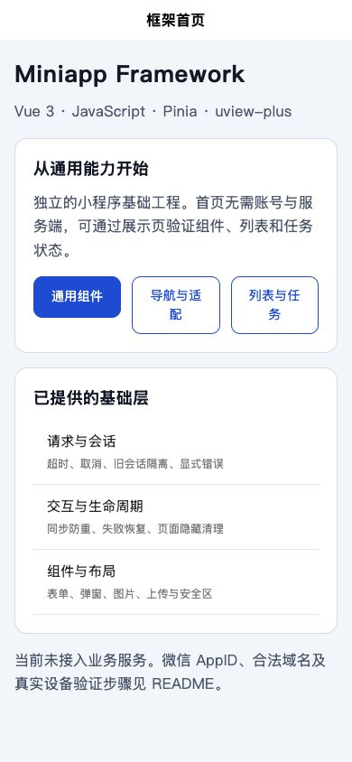
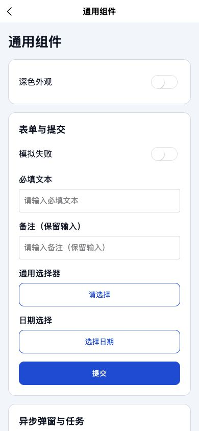

# Uni Miniapp Framework

[](https://github.com/wn228664/uni-miniapp-framework/actions/workflows/verify.yml)

独立的微信小程序通用框架，UI 使用 **uView 的 Vue 3 分支 uview-plus 3.8.138**：**uni-app / Vue 3 / JavaScript / Pinia / uview-plus / Vite / SCSS**。项目源码使用 JS 和 Vue SFC，不包含 TS 源文件。依赖库内部的类型声明不属于项目源码。

首页和组件展示不依赖后端或账号。没有业务页面、业务成功码、生产地址、支付/推送/客服 SDK、服务端密钥或发布凭证。示例数据只存在于明确标注的展示页。

## 运行截图

2026-11-03 采集，来自源码版本 `b520cdb` 的 **H5 辅助预览构建**，移动视口为 390 × 844 CSS px。截图展示同一份 uni-app / uview-plus 框架的实际预览界面；微信开发者工具和微信真机运行仍需独立验证。

| 框架首页与基础能力入口 | 通用表单与组件展示 |
| --- | --- |
|  |  |

组件页包含主题、输入与校验、选择器、日期、异步弹窗、任务、图片及状态反馈，展示数据只在本地使用。

## 当前验证状态

本地已通过源码检查、ESLint、Prettier、33项测试、微信小程序生产编译与H5辅助预览构建。H5已检查表单、弹窗、图片、分页、主题、键盘焦点及六种布局尺寸。

微信开发者工具和真机运行尚未验收。2026-11-03的依赖审计仍有51项告警（22 high / 19 moderate / 10 low）；签名校验另有公钥缺失记录。详细结果与适用边界见 [验证记录](docs/VALIDATION.md) 和 [依赖说明](docs/DEPENDENCIES.md)，不能由本地构建结果推断生产环境全部通过。

## 快速启动

已验证工具链 Node.js 22.21.1、npm 10.9.4。使用 `.nvmrc` / package.json engines 约定的 Node 22；所有依赖由 package-lock.json 锁定。

```sh
git clone https://github.com/wn228664/uni-miniapp-framework.git
cd uni-miniapp-framework
npm ci
cp .env.example .env.local
npm run dev:mp-weixin
```

微信开发者工具导入 `dist/dev/mp-weixin`。该命令持续监听源码；生产构建用 `npm run build:mp-weixin`，导入 `dist/build/mp-weixin`。未设置 AppID 时，生成工具提供的 touristappid，仅代表访客配置，不等于有发布或真机权限。

首次导入时配置自己的微信 AppID，并在开发者工具和真机检查合法域名、隐私授权、输入、图片及安全区。框架不携带特定应用的 AppID 或密钥。

```sh
npm run verify          # 源码/路由检查 → lint → 单测 → 微信构建 → H5预览构建
npm run dev:h5          # 组件辅助预览，默认 http://127.0.0.1:5175
npm run build:h5        # 辅助预览产物 dist/build/h5
```

H5 仅辅助检查交互、布局与组件，不能替代微信能力验证。其它小程序、APP、SSR 尚未设为交付目标。

## 配置

| 配置 | 用途 |
| --- | --- |
| VITE_APP_TITLE | 页面框架标题，默认 Miniapp Framework |
| VITE_API_BASE_URL | 绝对 HTTP(S) API 基地址，默认为空；空值允许启动，发请求时抛 API_NOT_CONFIGURED |
| UNI_MP_APPID | 可选微信 AppID，构建/监听完成后注入生成的 project.config.json；源 manifest 保持通用 |

修改配置后重新启动编译。`.env.local` 不提交。前端环境变量会进入产物，不能放 AppSecret、私钥或服务端凭证。微信合法域名、隐私授权与真实权限由使用该框架的新应用配置；默认保持域名检查开启，统计关闭。

## 目录

```text
src/
  app/services.js      应用依赖组装、注册路由
  core/                请求、上传、取消、动作、分页、会话、存储、导航、媒体、反馈、错误
  platform/uni.js      显式平台 API 引用，兼容 uni-app 按需编译
  stores/              Pinia 会话与非敏感偏好
  composables/         页面任务清理、网络连接状态
  components/          通用 UI 组件
  pages/index/         本地首页
  packages/showcase/   分包的组件/列表演示
  utils/               格式化、校验、query、防抖/节流
  styles/              主题、间距、安全区和公共布局
  pages.json           页面/分包/easycom 配置
  manifest.json        中性平台配置
```

依赖方向：页面组合组件 → 状态/控制器 → 注入服务 → core / platform。core 可以使用测试适配器，不依赖 Vue 或真实微信容器。UI 组件不解释业务接口。

## 常用封装

| 能力 | 核心边界 |
| --- | --- |
| request / upload | 保留平台 Task，取消/超时立即结束 Promise；旧会话不回填；上传必须注入 decode |
| createAction | 同步防重、错误/取消释放、旧 finally 不影响新周期 |
| createPagination | 刷新取消旧页、失败不推进页码、稳定 key 去重、显式 hasMore |
| createStorage | key 前缀、JSON 版本、TTL、读失败 fallback、写失败明确抛错 |
| navigation | 仅注册页面、认证/权限入口、Tab/参数/安全返回、防重复跳转 |
| media / feedback | 选择/压缩图片、可取消；Loading owner 计数、失败成对关闭 |
| AppForm / AppField / AppButton | 保留输入、运行时校验、异步提交与失败反馈 |
| AppDialog | 受控打开、独立确认周期、取消与旧结果隔离、正文内部滚动 |
| AppList / AppState | 刷新/分页、骨架、空态、错误/重试与终态 |
| AppUpload / AppImage | 单图选择、大小校验、可选压缩、注入上传、取消/移除、失败占位 |
| AppControl / AppSwitch | 统一触控尺寸、键盘入口、受控布尔值与可访问名称 |
| AppPage / AppNavbar | 亮/暗偏好、断网提示、安全区与自定义导航的胶囊避让 |

参数、示例和生命周期责任见 [通用封装指南](docs/COMMON_COMPONENTS.md)。扩展与取舍见 [架构决策](docs/ARCHITECTURE.md)，依赖来源与审计见 [依赖说明](docs/DEPENDENCIES.md)，UI 接入与升级约束见 [uView 配置](docs/UI_FRAMEWORK.md)。

## 接入真实服务

通过 `useServices()` 获取 request / upload / navigation / media / feedback。request 返回 `{ promise, cancel }`，也可接收框架 cancellation token；响应原样交给调用方。不自动重试写操作，不假定 code=0/200 等业务成功码。

```js
const task = request('/items', { data: query })
const payload = await task.promise
// 页面离开或请求被替代时 task.cancel()。
```

`session.set({ token, permissions })` 由真实认证结果提供；会话默认为内存状态。服务端才是最终鉴权边界。用户缓存若需要跨账号持久化，应使用独立账号命名空间并在退出时清理自己的键。

上传通过 `upload('/upload', filePath, { decode, onProgress, token }).promise` 接入。decode 根据真实文档返回 HTTP(S) URL；没有 upload 回调时 AppUpload 只有本地选择/预览，并在界面明确说明。默认没有虚构上传地址。

## 新项目扩展

1. 修改名称、AppID、图标、主题和环境配置。
2. 新页面注册到 pages.json，同时更新 app/services.js 的路由清单；主包保留启动入口，较重模块放分包。
3. 在新服务模块定义业务请求/响应适配，不改通用请求层的成功码规则。
4. 复用列表、表单、弹窗与任务封装，分别处理页面隐藏与卸载。
5. 执行 verify，并在微信开发者工具和真机验证目标能力。

列表展示页默认手动分页，可开启“滚动自动加载”。小程序页面默认使用页面滚动。复杂局部区域可采用明确高度的 scroll-view，同一区域只保留一个滚动 owner；弹窗正文独立滚动。包体和启动性能要在实际目标端测量，编译字节数不是客户端下载包体或首屏耗时。

## 质量与验证边界

代码与注释的统一标准见 [质量约定](docs/CODE_QUALITY.md)，组件与函数契约同时写在源码和使用指南中。

公开函数使用 JS 与必要的 JSDoc；通用表单字段为标量，日期保存本地 YYYY-MM-DD，校验规则必须同步返回文本或空值。注释解释契约、取消、代次与资源释放。测试覆盖重复触发、失败恢复、超时/取消、迟到结果、存储、导航、分页和媒体边界。UI 示例提供失败开关，不将本地演示当真实后端成功。

CI 只检查与构建，不包含上传、发布或业务凭证。H5 预览、微信编译、微信工具运行和微信真机验收是不同证据；初始结果见 [验证记录](docs/VALIDATION.md)。

## 常见问题

- 请求提示 API_NOT_CONFIGURED：先配置真实 API_BASE_URL，默认空地址是为了独立运行。
- 上传没有网络请求：展示页未注入上传服务，仅本地预览。
- 小程序找不到页面：检查 pages.json 与路由注册清单是否一致。
- 修改 AppID 未生效：重新启动编译并检查生成的 project.config.json。
- H5 能用但微信异常：检查 API/权限/组件的目标平台能力，不能由 H5 结果推断微信成功。
- npm audit 有告警：见依赖说明；不使用 npm audit fix --force 自动替换整套编译器。

## 文档导航

| 文档 | 内容 |
| --- | --- |
| [通用封装指南](docs/COMMON_COMPONENTS.md) | 函数、组件、参数、事件、错误与生命周期责任 |
| [架构决策](docs/ARCHITECTURE.md) | 模块边界、状态归属、平台适配与扩展原则 |
| [uView配置](docs/UI_FRAMEWORK.md) | Vue 3分支、easycom、主题、字体与升级检查 |
| [代码与注释标准](docs/CODE_QUALITY.md) | 职责、复用、错误处理、JSDoc和注释准确性 |
| [依赖说明](docs/DEPENDENCIES.md) | 固定版本、registry、许可与已知审计风险 |
| [验证记录](docs/VALIDATION.md) | 实际执行结果、尺寸矩阵及待环境确认项 |

## GitHub与CI

仓库：[wn228664/uni-miniapp-framework](https://github.com/wn228664/uni-miniapp-framework)，默认分支main。push/PR会触发Framework checks，使用Node 22.21.1运行npm ci和npm run verify。CI实时结果以页面检查记录为准，不包含微信真机、上传发布或真实后端验收。

建议从新分支开始扩展；提交前执行verify，更新对应使用说明和测试。不要提交node_modules、dist、.env.local、微信私有工具配置、证书或真实凭证。依赖版本与锁文件一起维护。
